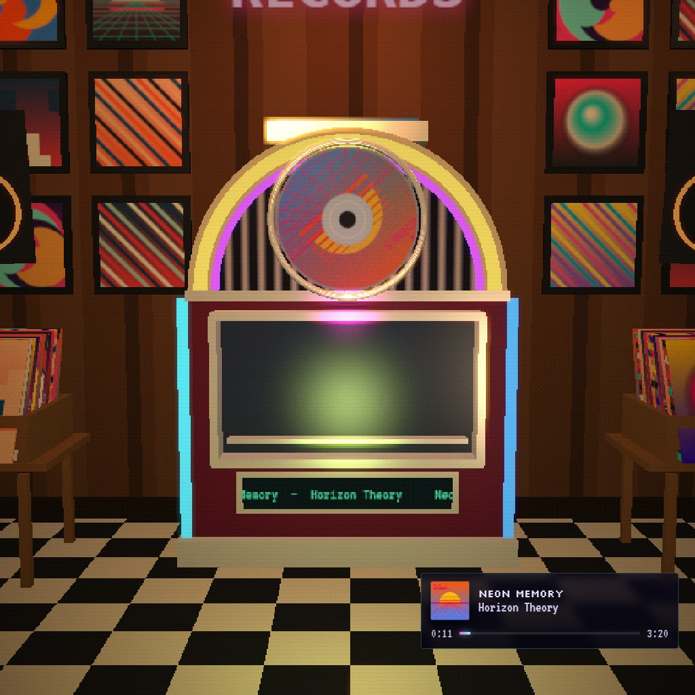

# DISC//SHELF

Your Spotify library as a wall of jewel cases. Every playlist is a binder on a shelf, every song a
disc with its real cover. Pick one and a robot arm carries it across the room to the jukebox.

- **Web:** <https://diskshelf.saladsync.ca>
- **Wallpaper Engine:** fully supported, as a live wallpaper.
  [Get it on the Steam Workshop](https://steamcommunity.com/sharedfiles/filedetails/?id=3818066442)



## What's in it

- Playlists as binders, songs as CDs, vinyl or cassettes, with a jukebox, turntable or boombox to match.
- Four rooms: record store, 90s bedroom, arcade, vapor lounge, dressed with your own covers.
- An app-owned queue you can reorder, search that lights up the wall, and a room that moves to the bass.
- No backend: Three.js and the Spotify Web API in the browser, signed in with PKCE.

## Wallpaper Engine

Subscribe on the [Steam Workshop](https://steamcommunity.com/sharedfiles/filedetails/?id=3818066442)
and pick DISC//SHELF. Out of the box it runs on a demo library and reacts to whatever your PC plays:
the bass comes from the real system audio, and it shows what is playing from Windows media controls.

To see your own library and play discs from the desktop, sign in from the wallpaper's settings. The
steps are listed there, and in [WALLPAPER.md](WALLPAPER.md) along with how to build it yourself.

## Running the website locally

```
npm install
npm run dev
```

Open <http://127.0.0.1:5173>, follow the four steps on the start screen to create a free Spotify app,
and connect. Playing music needs Spotify Premium; the demo needs no account. To prefill your Client
ID, copy `.env.example` to `.env.local`.

`npm run build` builds the site into `dist/`, `npm run wallpaper` builds the wallpaper into
`dist-wallpaper/`. [PITCH.md](PITCH.md) covers the guided demo at `/pitch/`.
